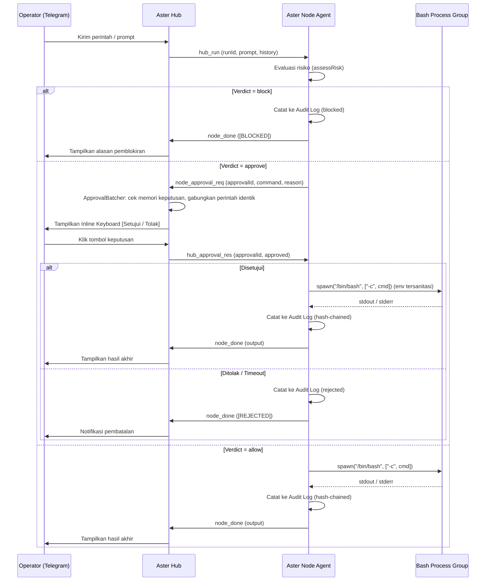

# Arsitektur Aster Fleet Manager

Dokumen ini menjelaskan desain internal, protokol komunikasi, dan alur kerja komponen **Aster Hub** serta **Aster Node Agent**.

---

## 1. Pembagian Peran Komponen

| Komponen | Lokasi | Tanggung Jawab Utama |
|---|---|---|
| **Aster Hub** (`src/hub/`) | 1 Server Koordinasi Pusat | Menjalankan Bot Telegram, menerima koneksi *inbound* WebSocket (`ws`/`wss`) dari seluruh node, memvalidasi token autentikasi, menyimpan state sesi chat (`HubStore`), meneruskan permintaan *approval* ke Telegram (digabung oleh `ApprovalBatcher`), dan mem-forward *alert* proaktif ke admin. **Hub sendiri tidak mengeksekusi shell operator.** Eksekusi di host Hub hanya terjadi lewat *embedded node* (lihat bagian 6), yang tunduk pada `assessRisk` dan *approval gate* yang sama dengan node lain. |
| **Aster Node** (`src/node/`) | Setiap Server / VPS Kantor | Menginisiasi koneksi *outbound* WebSocket ke Hub, mendeteksi distribusi OS (`distro.ts`), menjalankan loop AI tool-calling (`engine.ts`), menilai risiko perintah (`risk.ts`), mengeksekusi perintah dalam *process group* terisolasi (`executor.ts`), mencatat audit berantai hash (`audit.ts`), dan memantau kesehatan sistem (`alerts.ts`). |
| **Shared Core** (`src/shared/`) | Digunakan bersama | Kontrak protokol pesan (`protocol.ts`), klasifikasi risiko (`risk.ts`), pencatat & verifikator rantai audit (`audit.ts`), pemformatan Markdown ke HTML Telegram (`format.ts`), serta auto-update berbasis Git (`updater.ts`). |

Modul pendukung di `src/hub/`:

| Modul | Fungsi |
|---|---|
| `bot.ts` | Handler perintah Telegram, callback *approval*, dan forwarder *alert*. |
| `server.ts` | Server WS/WSS, registri node, koordinator *run*, dan endpoint loopback `/internal/fleet/*`. |
| `approval.ts` | `ApprovalBatcher`: penggabungan *approval* multi-node dan memori keputusan 5 menit. |
| `progress.ts` | `RunProgress`: indikator *typing*, fase kerja, timer, dan daftar langkah *tool* selama AI bekerja. |
| `fleet-ctl.ts` | CLI kecil yang dipanggil agen OpenCode di Hub untuk mengendalikan node lain lewat loopback. |
| `store.ts` | Persistensi atomik state Hub. |
| `index.ts` | Entrypoint: Hub, bot, *embedded node*, dan *auto-update poller*. |

---

## 2. Protokol Komunikasi WebSocket (`src/shared/protocol.ts`)

Seluruh komunikasi antara Hub dan Node menggunakan pesan JSON terstruktur di atas satu koneksi WebSocket persisten per node:

### A. Pesan dari Node ke Hub (`NodeToHubMsg`)
1. **`node_hello`**: Dikirim segera saat koneksi terbuka. Berisi `nodeId`, `token`, dan objek `NodeInfo` (`hostname`, `platform`, `arch`, `uptime`, `loadAvg`, `memory`, `distro`, `kernel`, `cpus`, `isRoot`).
2. **`node_heartbeat`**: Dikirim berkala setiap `HEARTBEAT_INTERVAL_MS` (default 15 detik) untuk memperbarui metrik *uptime*, *load average*, dan RAM bebas di registri Hub.
3. **`node_chunk`**: Mengalirkan potongan output teks/progress secara *real-time* selama eksekusi perintah atau *streaming* AI berlangsung.
4. **`node_approval_req`**: Meminta persetujuan interaktif kepada operator di Telegram ketika perintah berstatus `approve` (`runId`, `approvalId`, `command`, `reason`).
5. **`node_done`**: Menandakan eksekusi `runId` telah selesai, membawa `fullText`, opsional `error` (termasuk `"ABORTED"`), dan statistik `usage` token AI.
6. **`node_alert`**: Mengirim notifikasi proaktif (`warn` atau `ok`) saat penggunaan Disk, RAM, atau unit `systemd` melewati ambang batas atau kembali pulih.
7. **`node_pong`**: Balasan atas `hub_ping` dari Hub sebagai pemeriksaan koneksi hidup.

### B. Pesan dari Hub ke Node (`HubToNodeMsg`)
1. **`hub_welcome`**: Balasan autentikasi (`success: true/false`, `message`). Jika gagal, koneksi langsung ditutup oleh Hub.
2. **`hub_run`**: Meminta node menjalankan tugas baru (`runId`, `chatId`, `userId`, `userName`, `prompt`, `model`, `history`). `userName` dipakai untuk personalisasi sapaan AI.
3. **`hub_approval_res`**: Meneruskan keputusan operator (`approved: true/false`) atas `approvalId` tertentu.
4. **`hub_cancel`**: Memerintahkan node untuk segera membatalkan `runId` yang sedang berjalan dan menghentikan seluruh *process tree* shell terkait.
5. **`hub_ping`**: Pemeriksaan koneksi hidup; node membalas dengan `node_pong`.

---

## 3. Siklus Hidup Eksekusi Perintah

---

## 4. Dual-Engine AI (`ENGINE=opencode` & `ENGINE=local`) serta Built-in RPC (`src/node/engine.ts`)

`NodeEngine` menangani empat jalur eksekusi di setiap node:

1. **Built-in RPC**:
   - `__builtin:status`: Mengumpulkan 14 metrik sistem secara paralel (`status.ts`) dan merender dashboard monospace bergaya netdata tanpa memicu AI atau mengotori log audit perintah operator.
   - `__builtin:auditcheck`: Memverifikasi seluruh baris pada file `audit-<nodeId>.jsonl` dari hash `GENESIS` hingga baris terakhir dan melaporkan keutuhan rantai SHA-256.
   - `__builtin:models`: Mengambil daftar model yang tersedia (`listModels()` via `/api/model`) dari daemon OpenCode pada node aktif (atau daftar `modelChain` pada mode `local`) untuk ditampilkan saat operator memanggil `/model`.
   - `__builtin:reset`: Menghapus sesi OpenCode aktif untuk `chatId` terkait di node saat operator memanggil `/reset`.
   - `__builtin:ecc[:<subcommand>]`: Menampilkan status integrasi **ECC (Everything Claude Code)** di node aktif, daftar 31 *skills*, 27 *specialist agents*, 36 *workflow commands*, atau isi detail skill/agent/command tertentu.
2. **Direct Shell Mode (`$ <cmd>` atau `/exec <cmd>`)**:
   - Mengeksekusi perintah langsung melalui `NodeExecutor.runCommand` dengan penilaian risiko (`assessRisk`) dan *approval gate*.
3. **Bundled OpenCode Engine Mode (`ENGINE=opencode` — Default) + ECC Harness (`src/node/ecc.ts`)**:
   - Menggunakan paket resmi `@opencode/cli` yang telah dibundel di `node_modules/@opencode/cli`.
   - Saat node hidup dan `OPENCODE_URL` kosong, `ManagedOpenCodeServer` (`src/node/opencode-server.ts`) otomatis mencari port bebas di `127.0.0.1`, menghasilkan password acak 24-byte (`OPENCODE_SERVER_PASSWORD`), mengisolasi seluruh direktori `XDG_DATA_HOME`, `XDG_STATE_HOME`, `XDG_CACHE_HOME`, dan `XDG_CONFIG_HOME` di dalam direktori data node (`/var/lib/aster-node/opencode-<nodeId>`), memprovisi `.opencode/opencode.json` beserta *skills*, *instructions*, *prompts/agents*, *commands*, dan *plugins* dari **ECC** melalui `provisionOpenCodeEcc(configDir)`, serta menjalankan `opencode serve`.
   - `buildEccContextForPrompt(prompt)` di `src/node/ecc.ts` menerapkan **Trigger-Table Lazy Loading** dari ECC: mencocokkan kata kunci infrastruktur/SRE pada prompt operator (misalnya jaringan/ethtool/CRC $\rightarrow$ `network-interface-health`, WireGuard $\rightarrow$ `homelab-wireguard-vpn`, Docker $\rightarrow$ `docker-patterns`, PostgreSQL/MySQL/Redis $\rightarrow$ `postgres-patterns`/`redis-patterns`, audit kesiapan rilis $\rightarrow$ `production-audit`, keamanan/firewall $\rightarrow$ `security-review` + `agent-security-hardening`) dan menyuntikkan maksimal 2 skill paling relevan beserta aturan `safety-guard` (Careful Mode) dan `terminal-ops` ke dalam konteks sesi.
   - `OpenCodeRunner` (`src/node/opencode.ts`) membuat sesi per `chatId` dengan aturan `RULESET` ketat (`shell: ask`, `edit: ask`, `write: ask`, `read: ask`, `subagent: deny`, `question: deny`), menyuntikkan konteks sistem/distro Linux + hak akses (`root`/`non-root`) di pesan pertama sesi baru, memulihkan sesi secara otomatis jika terjadi ketidakcocokan `reasoning_content` saat berganti model, dan mem-polling permintaan izin di `/api/session/{sessionID}/permission`.
   - Setiap permintaan izin dari OpenCode dinilai oleh `assessRisk`:
     - `block`: Langsung ditolak (`reject`) dan dicatat ke audit log node (termasuk upaya membaca file rahasia via tool `read` maupun `shell`).
     - `allow` (pembacaan file non-rahasia via `read` atau perintah `shell` *read-only*): Otomatis diizinkan (`once`) dan dicatat ke audit log node tanpa mengganggu operator.
     - `approve` (perintah mutasi `shell` atau `edit`/`write` file): Mengirim `node_approval_req` ke Hub sehingga tombol **Setujui / Tolak** muncul di Telegram.
4. **Local AI Gateway Mode (`ENGINE=local`)**:
   - Menyusun *system prompt* yang dilengkapi informasi distro Linux (`distroContext()`) dan status *privilege* (`isRoot`), lalu memanggil endpoint kompatibel OpenAI (`GATEWAY_URL`).
   - Menyertakan riwayat percakapan ringkas per `(chatId, nodeId)` yang dikirim dari `HubStore`.
   - Mencegah pengulangan perintah identik lebih dari 2 kali dalam satu siklus dan mendukung rantai *fallback* model (`MODEL_NAME` $\rightarrow$ `MODEL_FALLBACK`).

---

## 5. Persistensi State di Hub (`src/hub/store.ts`)

`HubStore` menyimpan state operasional ke file JSON (`HUB_STATE_FILE`, mode `0600`) menggunakan mekanisme *atomic write* (`.tmp` + `rename`) dengan *debounce* 1 detik dan *flush* otomatis saat menerima sinyal `SIGINT`/`SIGTERM`:
- Pilihan node aktif per `chatId`.
- Riwayat percakapan padat per kombinasi `${chatId}:${nodeId}`.
- *Override* model AI per `chatId` (dari perintah `/model`).
- Akumulasi pemakaian token (`requests`, `promptTokens`, `completionTokens`) per `chatId`.

---

## 6. Embedded Hub Node & Fleet Controller (`src/hub/index.ts`, `src/hub/fleet-ctl.ts`)

Secara default (`HUB_EMBED_NODE=true`), proses Hub juga menjalankan satu node internal (`HUB_NODE_ID`, default `hub`) yang terhubung ke Hub sendiri lewat `ws://127.0.0.1:<port>` (atau `wss://` bila TLS aktif). Node ini memakai `NodeEngine` dan `NodeExecutor` yang sama dengan node biasa, termasuk audit berantai hash di `HUB_AUDIT_PATH`.

- **Engine**: `HUB_ENGINE` (fallback ke `ENGINE`), default `opencode` dengan daemon bundled. Port dan direktori datanya diatur lewat `HUB_OPENCODE_PORT` dan `HUB_OPENCODE_DATA_DIR`.
- **Konteks fleet**: sistem prompt agen Hub diperkaya ringkasan node yang sedang online lewat `buildFleetContextSummary`.
- **Kendali lintas node**: agen OpenCode di Hub memanggil `fleet-ctl.js` dengan subperintah `nodes`, `status`, `exec <node|all> "<cmd>"`, dan `broadcast "<cmd>"`. CLI ini menembak endpoint loopback `/internal/fleet/*` di Hub (hanya `127.0.0.1`, dengan cookie acak per proses), yang kemudian memanggil `executeRemoteCommand`. Perintah dikirim ke node target sebagai `$ <cmd>`, sehingga `assessRisk` dan *approval gate* tetap berlaku di node target.
- **Pemilihan target**: bila operator belum memilih node lewat `/use`, chat otomatis diarahkan ke node Hub. `/unuse` mengembalikan ke default ini.

---

## 7. Indikator Progres & Auto-Update

### Indikator progres (`src/hub/progress.ts`)
Selama AI bekerja, `RunProgress` menjaga umpan balik tetap hidup: aksi *typing* setiap 4,5 detik dan satu pesan status yang diperbarui berisi fase (`thinking`, `tool`, `writing`, `approval`, `shell`), waktu berjalan, dan daftar langkah *tool* terakhir. Perintah yang diblokir ditandai, dan pesan akan memberi petunjuk bila proses berjalan lama.

### Auto-update (`src/shared/updater.ts`)
`AutoUpdateMonitor` memeriksa remote Git setiap `AUTO_UPDATE_INTERVAL_MS` (default 120000) pada `AUTO_UPDATE_REMOTE` dan `AUTO_UPDATE_BRANCH` (kosong berarti branch yang sedang aktif). Bila ada commit baru:
1. Perubahan lokal di `dist/` dibuang agar tidak menghalangi pull.
2. `git pull --ff-only`; bila gagal, fallback ke `git reset --hard <remote>/<branch>`.
3. `npm ci --include=dev` (fallback `npm install`), lalu `npm run build`.
4. Bila build gagal, proses lama tetap berjalan dan error dilaporkan. Restart hanya dijadwalkan setelah build sukses.

Perhatikan langkah 2: fallback `reset --hard` menimpa perubahan lokal pada file yang dilacak Git. Jangan menyimpan modifikasi manual di direktori aplikasi pada node dengan `AUTO_UPDATE=true`.
