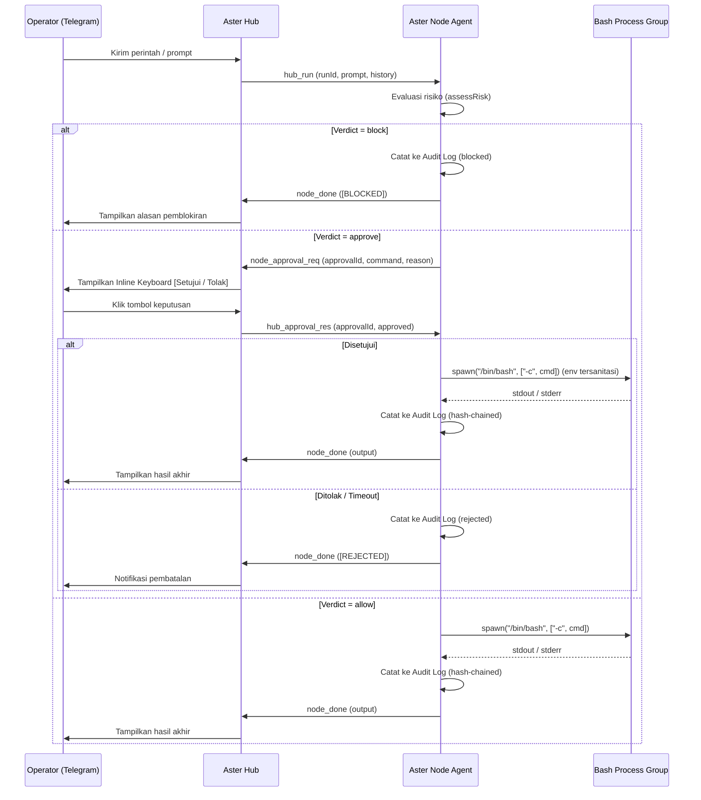

# Arsitektur Aster Fleet Manager

Dokumen ini menjelaskan desain internal, protokol komunikasi, dan alur kerja komponen **Aster Hub** serta **Aster Node Agent**.

---

## 1. Pembagian Peran Komponen

| Komponen | Lokasi | Tanggung Jawab Utama |
|---|---|---|
| **Aster Hub** (`src/hub/`) | 1 Server Koordinasi Pusat | Menjalankan Bot Telegram, menerima koneksi *inbound* WebSocket (`ws`/`wss`) dari seluruh node, memvalidasi token autentikasi, menyimpan state sesi chat (`HubStore`), meneruskan permintaan *approval* ke Telegram, dan mem-forward *alert* proaktif ke admin. **Hub tidak pernah mengeksekusi perintah shell di host-nya sendiri.** |
| **Aster Node** (`src/node/`) | Setiap Server / VPS Kantor | Menginisiasi koneksi *outbound* WebSocket ke Hub, mendeteksi distribusi OS (`distro.ts`), menjalankan loop AI tool-calling (`engine.ts`), menilai risiko perintah (`risk.ts`), mengeksekusi perintah dalam *process group* terisolasi (`executor.ts`), mencatat audit berantai hash (`audit.ts`), dan memantau kesehatan sistem (`alerts.ts`). |
| **Shared Core** (`src/shared/`) | Digunakan bersama | Kontrak protokol pesan (`protocol.ts`), klasifikasi risiko (`risk.ts`), pencatat & verifikator rantai audit (`audit.ts`), serta pemformatan Markdown ke HTML Telegram (`format.ts`). |

---

## 2. Protokol Komunikasi WebSocket (`src/shared/protocol.ts`)

Seluruh komunikasi antara Hub dan Node menggunakan pesan JSON terstruktur di atas satu koneksi WebSocket persisten per node:

### A. Pesan dari Node ke Hub (`NodeToHubMsg`)
1. **`node_hello`**: Dikirim segera saat koneksi terbuka. Berisi `nodeId`, `token`, dan objek `NodeInfo` (`hostname`, `platform`, `arch`, `uptime`, `loadAvg`, `memory`, `distro`, `kernel`, `cpus`, `isRoot`).
2. **`node_heartbeat`**: Dikirim berkala setiap `HEARTBEAT_INTERVAL_MS` (default 15 detik) untuk memperbarui metrik *uptime*, *load average*, dan RAM bebas di registri Hub.
3. **`node_chunk`**: Mengalirkan potongan output teks/progress secara *real-time* selama eksekusi perintah atau *streaming* AI berlangsung.
4. **`node_approval_req`**: Meminta persetujuan interaktif kepada operator di Telegram ketika perintah berstatus `approve` (`runId`, `approvalId`, `command`, `reason`).
5. **`node_done`**: Menandakan eksekusi `runId` telah selesai, membawa `fullText`, opsional `error` (termasuk `"ABORTED"`), dan statistik `usage` token AI.
6. **`node_alert`**: Mengirim notifikasi proaktif (`warn` atau `ok`) saat penggunaan Disk, RAM, atau unit `systemd` melewati ambang batas atau kembali pulih.

### B. Pesan dari Hub ke Node (`HubToNodeMsg`)
1. **`hub_welcome`**: Balasan autentikasi (`success: true/false`, `message`). Jika gagal, koneksi langsung ditutup oleh Hub.
2. **`hub_run`**: Meminta node menjalankan tugas baru (`runId`, `chatId`, `userId`, `prompt`, `model`, `history`).
3. **`hub_approval_res`**: Meneruskan keputusan operator (`approved: true/false`) atas `approvalId` tertentu.
4. **`hub_cancel`**: Memerintahkan node untuk segera membatalkan `runId` yang sedang berjalan dan menghentikan seluruh *process tree* shell terkait.

---

## 3. Siklus Hidup Eksekusi Perintah

---

## 4. Built-in RPC & AI Tool-Calling Loop (`src/node/engine.ts`)

`NodeEngine` menangani tiga jalur eksekusi:
1. **Built-in RPC**:
   - `__builtin:status`: Mengumpulkan 14 metrik sistem secara paralel (`status.ts`) dan merender dashboard monospace bergaya netdata tanpa memicu AI atau mengotori log audit perintah operator.
   - `__builtin:auditcheck`: Memverifikasi seluruh baris pada file `audit-<nodeId>.jsonl` dari hash `GENESIS` hingga baris terakhir dan melaporkan keutuhan rantai SHA-256.
2. **Direct Shell Mode (`$ <cmd>` atau `/exec <cmd>`)**:
   - Mengeksekusi perintah langsung melalui `NodeExecutor.runCommand` dengan penilaian risiko dan *approval gate*.
3. **AI SRE Mode**:
   - Menyusun *system prompt* yang dilengkapi informasi distro Linux (`distroContext()`) dan status *privilege* (`isRoot`).
   - Menyertakan riwayat percakapan ringkas per `(chatId, nodeId)` yang dikirim dari `HubStore`.
   - Mencegah pengulangan perintah identik lebih dari 2 kali dalam satu siklus.
   - Jika pengguna meminta tindakan perbaikan (*action intent*), membatasi jumlah pembacaan berturut-turut (`MAX_READ_ONLY_STEPS`) agar agen fokus menyelesaikan masalah.
   - Mendukung rantai *fallback* model (`MODEL_NAME` $\rightarrow$ `MODEL_FALLBACK`).

---

## 5. Persistensi State di Hub (`src/hub/store.ts`)

`HubStore` menyimpan state operasional ke file JSON (`HUB_STATE_FILE`, mode `0600`) menggunakan mekanisme *atomic write* (`.tmp` + `rename`) dengan *debounce* 1 detik dan *flush* otomatis saat menerima sinyal `SIGINT`/`SIGTERM`:
- Pilihan node aktif per `chatId`.
- Riwayat percakapan padat per kombinasi `${chatId}:${nodeId}`.
- *Override* model AI per `chatId` (dari perintah `/model`).
- Akumulasi pemakaian token (`requests`, `promptTokens`, `completionTokens`) per `chatId`.
